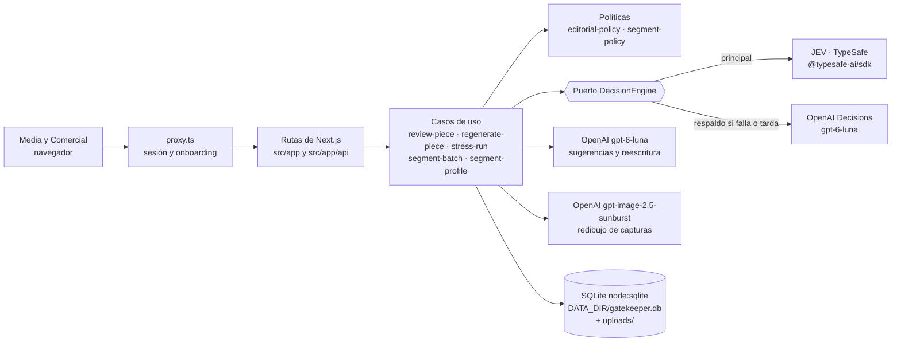

# Gatekeeper Editorial 30X

> **JEV decide, el LLM corrige, y el equipo solo revisa lo que de verdad importa.**

## 🎤 [PITCH AQUÍ → gatekeeper-30x.michaelliendo.com/pitch](https://gatekeeper-30x.michaelliendo.com/pitch/index.html)

## 🚀 [DEMO EN VIVO → gatekeeper-30x.michaelliendo.com](https://gatekeeper-30x.michaelliendo.com)

📘 [Playbook](https://gatekeeper-30x.michaelliendo.com/playbook/index.html)

Decisiones de 30X que [JEV de TypeSafe](https://docs.typesafe.ai) toma miles de veces al día,
en milisegundos, para que los equipos de Media y Comercial dejen lo repetitivo y se enfoquen en
lo que de verdad necesita criterio. Dos ya funcionan sobre el mismo motor:

1. **Media: ¿esta pieza sale?** JEV decide si cada pieza de contenido se **aprueba, se manda a
   mejorar, va a una persona o se descarta**; con un clic la IA reescribe lo que falló y JEV
   vuelve a revisar la versión nueva.
2. **Comercial: ¿a qué programa va este inscrito de Luma y lo llamamos ya?** JEV decide
   programa, cargo, madurez en IA y si la persona está lista para un asesor; el código elige la
   siguiente acción.

**Qué cambia para los equipos:**
- **Media** deja de revisar pieza por pieza: solo ve lo dudoso, con el porqué de cada alerta, y
  la IA corrige lo que falló en vez de reescribirlo a mano. Nada riesgoso sale sin una persona.
- **Comercial** sabe a quién llamar primero y qué ofrecerle, y la recomendación se recalcula
  cuando cambia un dato.
- **Todos** usan el mismo criterio, escrito como reglas que el equipo ajusta sin programar, y
  cada decisión del editor sirve para seguir mejorándolo.

**Medido en producción:** 1.000 decisiones reales en **4,5 s** (222 por segundo, 128 ms cada
una, p95 250 ms) sin un solo respaldo.

Proyecto del equipo **DevGain** para el **Hackathon 30X (octubre 2026) · Reto 30X: JEV**.

| | |
|---|---|
| Demo en línea | https://gatekeeper-30x.michaelliendo.com |
| Playbook (8 slides) | https://gatekeeper-30x.michaelliendo.com/playbook/index.html · fuente: [`docs/playbook/`](docs/playbook/) · versión en texto: [`docs/playbook/playbook.md`](docs/playbook/playbook.md) |
| Pitch (10 láminas) | **https://gatekeeper-30x.michaelliendo.com/pitch/index.html** · fuente: [`docs/pitch/`](docs/pitch/) · guion: [`docs/pitch/guion.md`](docs/pitch/guion.md) |
| Video demo | [VIDEO] |
| Repositorio | https://github.com/Michael-Liendo/gatekeeper-30x |

## Qué es y qué resuelve

La IA multiplicó lo que produce un equipo de contenido como el de 30X (posts, guiones, clips,
newsletters, miniaturas), pero nadie multiplicó la revisión: el cuello de botella pasó de crear
a aprobar. El editor revisa a mano decenas de piezas generadas con IA, cada persona usa su
criterio, se rehace trabajo y siempre está el miedo a que algo riesgoso salga. Pasarlo todo por
un LLM tampoco resuelve: no devuelve un "sí o no" confiable.

Gatekeeper Editorial pone a JEV como primer filtro: responde preguntas tipadas sobre cada pieza
(tema, relevancia, si es promocional, si promete de más, si tiene riesgo de marca…) y el código
aplica la política editorial de la marca para decidir la ruta:

| Ruta | En la app | Qué pasa |
|---|---|---|
| `AUTO_APPROVE` | **Aprobado** | Se publica sin que nadie haga nada. Sin LLM. |
| `ENRICH_WITH_LLM` | **Mejorar con IA** | Zona gris: un LLM propone cambios y la pieza pasa a "Por mejorar". |
| `HUMAN_REVIEW` | **Revisar** | Riesgo, tema fuera de línea o poca seguridad: lo decide el editor. |
| `REJECT` | **Descartado** | Spam o fuera de tema con alta seguridad. Queda registrado el porqué. |

Cada decisión explica qué regla se disparó (por ejemplo, "Demasiado promocional (0,91)").
Nada riesgoso se aprueba solo y, si JEV no responde, la pieza va a una persona: **nunca se
aprueba sin respuesta**.

## Cómo funciona

### 1. Ingreso con email y onboarding que lee la web de la marca
- `/ingresar`: solo email (y nombre la primera vez). Crea la cuenta y una sesión con cookie
  `httpOnly`. No hay contraseñas: es una demo.
- `/bienvenida`: pegas la web de tu marca (por ejemplo `30x.com`) y **"Analizar mi marca"**
  la lee y prellena el perfil con IA: nombre, descripción, audiencia, tono, temas, lo que vende,
  temas prohibidos y colores. Lo revisas, lo editas y confirmas.
- Las preguntas a JEV se construyen con ese perfil: "¿ofrece algo que **tu marca** no vende?",
  "¿encaja con **tu** línea editorial?". Se edita después en `/marca`.

### 2. Subir una pieza (captura o texto) → JEV → ruta
- `/nueva`: arrastras una captura (PNG/JPG hasta 4 MB, también con Ctrl/Cmd+V), pegas el texto
  o ambos, y eliges formato y canal.
- JEV responde todas las preguntas en una sola llamada (128 ms por pieza de texto, ~0,3 s con imagen). Las
  capturas también las juzga JEV: lee el texto visible y considera lo que muestra.
- El código aplica los umbrales y abre `/pieza/[id]` con la ruta, el porqué y el estado.

### 3. Bandeja, tablero e historial
- **Bandeja** (`/`): lo que necesita tu ojo, con KPIs (aprobado solo, necesita tu revisión,
  descartado) y pestañas Pendientes / Resueltas. El editor aprueba o rechaza con un clic.
- **Tablero** (`/tablero`): columnas Por revisar · Por mejorar · Aprobado · Rechazado; las
  tarjetas se mueven con un menú o arrastrando.
- **Mis piezas** (`/mis-piezas`): lo que subió cada persona y qué le pidieron cambiar.
- **Historial**: cada pieza guarda autor, rol (Diseño, Copy, Editor, Otro), versiones y una
  línea de tiempo (subida, revisión de JEV, cambios de estado, versiones).

### 4. Regenerar con IA → JEV verifica
En una pieza que no pasó, **"Regenerar con IA"**:
1. Un LLM (OpenAI `gpt-6-luna`) reescribe título y texto **con la voz de la marca**,
   corrigiendo solo lo que JEV marcó, sin inventar datos ni ofrecer lo que la marca no vende.
2. Si la pieza era una captura, `gpt-image-2.5-sunburst` (calidad alta) redibuja la imagen con el texto corregido.
3. **JEV revisa la versión nueva** con las mismas preguntas y la propuesta trae su veredicto.
4. Ves antes/después y decides: **"Guardar como nueva versión"** (Versión 2, Versión 3…).

Ejemplo real en producción: una captura de spam → **Descartado** → el LLM la reescribió con la
voz de 30X y la imagen se redibujó en el lima de la marca → JEV: **Aprobado** → Versión 2.

### 5. Política editorial con presets
`/politica`: tres estilos listos (**Estricto**, **Equilibrado** —el calibrado, recomendado— y
**Flexible**) y "Ajustes avanzados" para mover cada umbral. Los cambios se aplican al momento
sobre lo ya revisado, sin volver a llamar a JEV ni hacer deploy: los umbrales son datos.

### 6. Demo con 45 piezas de 30X
En la Bandeja, **"Revisar contenido de ejemplo"** pasa por JEV 45 piezas simuladas de 30X
(15 para aprobar, 10 para mejorar, 10 para revisión humana, 10 spam; ver
[`docs/04-dataset.md`](docs/04-dataset.md)). `/contenido` las lista y `/metricas` muestra
cuánto se resuelve solo, cuánto llega a una persona, cuánto acierta y qué tan rápido.

### 7. Prueba de escala
En `/metricas`, **"Correr 1.000 decisiones"** lanza 1.000 decisiones reales de contenido contra
JEV (solo texto, sin caché, 32 a la vez) y muestra tiempo total, decisiones por segundo, p50/p95
y quién respondió. Una corrida por minuto por usuario. Medido el 17 oct 2026 con
`jev-1.13.0`: **4,5 s · 222 decisiones por segundo · 128 ms (p95 250 ms) · 0 respaldos**.

### 8. Inscritos de Luma (segmentación)
La idea n.° 1 de 30X, con el mismo motor. En **Inscritos** (`/segmentos`):
- **"Segmentar 100 inscritos de ejemplo"** decide sobre perfiles anónimos de
  `data/perfiles-30x.csv` (697 que compartió 30X) y compara con el programa que sugiere 30X.
- **"Nuevo inscrito"** segmenta un perfil en vivo; **"Cambió su situación"** cambia un dato,
  recalcula y muestra el antes y el ahora.
- JEV ve solo lo que alguien deja al inscribirse (rol, país, dolor, objetivo, temas, relación
  con 30X), nunca las etiquetas ni el CRM de 30X. Responde 5 preguntas en una pasada
  (`program`, `seniority`, `ai_maturity`, `sales_ready`, `has_context`) y
  `domain/segment-policy.ts` elige: **pasar a un asesor**, **enviar la propuesta**, **nutrir
  con clases gratis** o **revisión humana**.
- Medido con JEV sobre 200 perfiles: **55,5 %** coincide con el programa de 30X (60 % donde 30X
  sugirió uno; **95 % en AI Sales**), **88 %** de precisión en "listo para un asesor", 93 ms por
  persona. Primera iteración sobre perfiles muy escasos; detalle en
  [`docs/12-segmentacion.md`](docs/12-segmentacion.md).

## Preguntas tipadas y umbrales

JEV contesta 12 preguntas en una pasada. **JEV decide, el código calcula**: contar, sumar y
comparar con umbrales vive en `domain/editorial-policy.ts`, nunca dentro de una pregunta.

| Tipo | Preguntas |
|---|---|
| `choice` | Tema (los temas de la marca + "Otro") · Formato (post, guion, clip, newsletter, otro) |
| `score` | Relevancia para la audiencia · Accionable · Potencial de alcance (solo informativo) |
| `yes_no` | Demasiado promocional · Promesas exageradas · Datos sin fuente · Riesgo de marca · Ofrece algo que la marca no vende · Spam · Encaja con la línea editorial |

Política **Equilibrado** (calibrada con JEV real, ver [`docs/05-calibracion.md`](docs/05-calibracion.md)):

| Umbral | Valor | Efecto |
|---|---|---|
| Spam | ≥ 0,60 | Descartado |
| Riesgo de marca, promesas exageradas u oferta ajena | ≥ 0,60 | Revisión humana |
| Seguridad mínima (piso de zona gris) | < 0,20 | Revisión humana |
| Seguridad para aprobar solo | ≥ 0,50 | Aprobado si además… |
| Ninguna alerta en rojo | < 0,50 | …no hay alertas y… |
| Puntaje editorial (relevancia + accionable − promocional − sin fuente) | ≥ 0,50 | …el puntaje alcanza |
| Todo lo demás | — | Mejorar con IA |

Resultados medidos en las 45 piezas etiquetadas: coincidencia con la ruta esperada de 53 % con
la política inicial a **80–87 %** con la calibrada (según la corrida; la última, con imágenes y
preguntas por marca, 80 %), **42 %** resuelto sin persona, **0** piezas riesgosas aprobadas
solas y ~0,3 s por pieza con imagen. A escala, 1.000 decisiones de texto en 4,5 s. El detalle de decisiones, umbrales, quién opera y cómo se mide
está en el [playbook](docs/playbook/playbook.md).

## Arquitectura



**DDD liviano**: un módulo por área de negocio, con las dependencias hacia adentro
(`ui` / `infrastructure` → `application` → `domain`). Las rutas solo validan (zod), llaman un
caso de uso y responden. Reglas completas en [`AGENTS.md`](AGENTS.md).

```
src/
├── app/                        # Rutas de Next.js 16 (App Router). Delgadas.
│   ├── (auth)/ingresar         # Ingreso con email
│   ├── (onboarding)/bienvenida # Onboarding de marca
│   ├── (app)/                  # Bandeja, tablero, mis-piezas, contenido, nueva,
│   │                           # pieza/[id], politica, metricas, marca, segmentos
│   └── api/                    # Route handlers (ver tabla)
├── modules/
│   ├── content-review/         # El gatekeeper: preguntas, política, JEV, LLM, regeneración
│   │   ├── domain/             # editorial-questions, editorial-policy, métricas (TS puro)
│   │   ├── application/        # review-piece, review-batch, regenerate-piece
│   │   ├── infrastructure/     # jev-client, DecisionEngine (JEV + fallback OpenAI), openai-*
│   │   └── ui/                 # Bandeja, nueva pieza, política, métricas
│   ├── segmentation/           # Inscritos de Luma: preguntas, segment-policy, lote y recálculo
│   ├── brand/                  # Perfil de marca y "Analizar mi marca" (lectura del sitio + IA)
│   ├── accounts/               # Usuarios, sesiones, ingreso
│   └── workspace/              # CRM liviano: piezas, estados, versiones, historial, tablero
├── shared/
│   ├── config/env.ts           # Variables de entorno validadas (server-only)
│   ├── db/sqlite.ts            # Conexión SQLite (node:sqlite, sin dependencias nativas)
│   └── ui/                     # Componentes genéricos
└── proxy.ts                    # Next.js 16 proxy: sin sesión → /ingresar; sin marca → /bienvenida
```

Decisiones técnicas clave:

- **JEV detrás de un puerto.** `DecisionEngine` tiene tres adaptadores: JEV (`jev-latest`,
  medido como `jev-1.13.0`) vía `@typesafe-ai/sdk`, OpenAI Decisions (`gpt-6-luna`) y uno de
  respaldo que usa OpenAI solo si JEV falla o pasa `DECISION_TIMEOUT_MS` (4 s por defecto).
  En la calibración se usó 0 veces. Toda llamada a TypeSafe pasa por
  `infrastructure/jev-client.ts`.
- **Persistencia simple.** SQLite con el módulo nativo `node:sqlite` (tablas `users`,
  `sessions`, `brands`, `pieces`, `piece_events`) y las capturas en `DATA_DIR/uploads/`.
- **Auth en el proxy.** `src/proxy.ts` (el antiguo middleware de Next.js) protege todo menos
  `/ingresar`, `/api/health` y `/api/auth/*`; las APIs responden 401 en español.
- **Secretos solo en el servidor.** `shared/config/env.ts` es `server-only`.
- **Stack:** Next.js 16 · React 19 · TypeScript · Tailwind v4 · zod · Biome · Docker.
- **CI** (`.github/workflows/validate.yml`): lint, typecheck, tests y build con **npm y con
  pnpm** en cada PR, para que los dos lockfiles nunca diverjan.

## API

Errores siempre como `{ error }` en español. Todo requiere sesión salvo lo indicado.

| Método | Ruta | Para qué |
|---|---|---|
| GET | `/api/health` | Healthcheck (público) |
| POST | `/api/auth/sign-in` | `{ email, name? }` → crea o abre la cuenta y la sesión (público) |
| POST | `/api/auth/sign-out` | Cierra la sesión (público) |
| GET / PATCH | `/api/me` | Usuario y marca actuales / cambiar rol |
| POST | `/api/brand/extract` | `{ url }` → borrador de perfil leyendo la web de la marca |
| GET / PUT | `/api/brand` | Leer / guardar el perfil de marca |
| GET / POST | `/api/pieces` | Listar piezas del usuario (`?status=`) / subir una pieza (revisada por JEV) |
| GET / PATCH | `/api/pieces/[id]` | Detalle con historial / mover de estado |
| POST | `/api/pieces/[id]/versions` | Guardar una versión nueva (JEV la vuelve a revisar) |
| GET | `/api/pieces/[id]/image` | Captura de la pieza (solo el dueño) |
| POST | `/api/regenerate` | Propuesta "Regenerar con IA" con el veredicto de JEV (no guarda) |
| POST | `/api/review` | Revisa el dataset de ejemplo (o algunos ids) con una política opcional |
| POST | `/api/review/piece` | Revisa una pieza suelta (texto y/o captura) sin guardarla |
| POST | `/api/enrich` | Sugerencias del LLM para una pieza |
| POST | `/api/decide` | Prueba manual del motor de decisiones con preguntas arbitrarias |
| POST | `/api/stress` | Prueba de escala: `{ count: 100 \| 1000 }` decisiones reales de contenido (1 por minuto) |
| POST | `/api/segment/run` | Segmenta una muestra fija de inscritos: `{ size: 50 \| 100 \| 200 }` → decisiones y métricas vs. 30X |
| POST | `/api/segment/profile` | Segmenta un inscrito `{ rol, pais, dolor, objetivo, temas, relacion, cambios? }`; con `cambios`, recalcula y devuelve antes y ahora |
| GET | `/api/content` | Las 45 piezas simuladas |

Contratos detallados: [`docs/06-contrato-marca.md`](docs/06-contrato-marca.md) y
[`docs/09-contrato-crm.md`](docs/09-contrato-crm.md).

## Correr en local

Requisitos: Node `>=22.18` (ver `.nvmrc`). Funciona con **npm** o **pnpm** (los dos lockfiles
están en el repo).

```bash
npm install                  # o: pnpm install
cp .env.example .env.local   # completa las claves
npm run dev                  # o: pnpm dev → http://localhost:3000
```

Variables de `.env.local`:

| Variable | Para qué |
|---|---|
| `TYPESAFE_API_KEY` | JEV (motor de decisiones principal) |
| `OPENAI_API_KEY` | Respaldo de decisiones, sugerencias, "Analizar mi marca" y "Regenerar con IA" |
| `DECISION_TIMEOUT_MS` | Tiempo que JEV tiene antes del respaldo (por defecto `4000`) |
| `DATA_DIR` | Carpeta de la base SQLite y las capturas (por defecto `./data`) |
| `DAILY_LIMIT_<BOLSA>_<USER\|GLOBAL>` | Opcional. Cambia un límite diario de uso (ver abajo); `0` lo bloquea |

**Límites diarios de uso.** Para que nadie agote las claves creando cuentas, cada persona
y la demo completa tienen un tope diario por bolsa. Son generosos: el uso normal no los toca.
El día es el día calendario UTC (se reinicia a las 19:00 de Bogotá). Al pasarlo, la API
responde `429` con un mensaje en español y `Retry-After`.

| Bolsa | Qué cuenta | Por persona | Total demo |
|---|---|---|---|
| `DECISIONS` | Decisiones de JEV/OpenAI (una por pieza o perfil) | 20.000 | 200.000 |
| `LLM` | Sugerencias, reescrituras y "Analizar mi marca" | 300 | 3.000 |
| `IMAGES` | Imágenes regeneradas | 30 | 300 |

Ejemplo: `DAILY_LIMIT_IMAGES_USER=10`. `GET /api/me/usage` muestra el uso de hoy.

Con una sola de las dos claves la app funciona con ese proveedor. Los modelos (JEV y OpenAI)
están fijos en el código, no en variables.

| Comando | Qué hace |
|---|---|
| `npm run dev` | Servidor de desarrollo |
| `npm run lint` / `npm run lint:fix` | Biome (lint + formato) |
| `npm run typecheck` | TypeScript |
| `npm test` | Tests con `node --test` |
| `npm run check` | lint + typecheck + tests + build (lo mismo que el CI) |

Con pnpm son los mismos scripts: `pnpm dev`, `pnpm check`, etc.

## Despliegue (Coolify)

La demo corre en Coolify con despliegue automático desde `main`.

1. Nuevo recurso → repositorio público → **Build Pack: Dockerfile** (la imagen se construye
   con `npm ci` y corre el build `standalone` de Next.js como usuario sin privilegios).
2. Puerto `3000`. Healthcheck: `/api/health`.
3. Variables: `TYPESAFE_API_KEY` y `OPENAI_API_KEY`. `DATA_DIR` ya es `/app/data` en la imagen.
4. **Volumen persistente en `/app/data`** para no perder usuarios, marcas, piezas y capturas
   en cada deploy.

## Datos

- Todo el contenido de ejemplo es **100 % simulado**: no hay personas reales, ni datos
  privados, ni nombres del equipo de 30X. Las únicas ofertas de 30X que aparecen son las públicas.
- Los usuarios de la demo son **cuentas de prueba**. No subas datos personales reales.

## Equipo

**DevGain** — Michael Liendo y Haron Acosta.

Más contexto en `docs/`: [reto](docs/01-reto.md), [diseño](docs/02-diseno.md),
[pitch](docs/03-pitch.md), [dataset](docs/04-dataset.md),
[calibración y prueba de escala](docs/05-calibracion.md),
[segmentación de inscritos](docs/12-segmentacion.md), [guía visual](docs/07-estilo.md).

## Licencia

[GNU AGPL-3.0](LICENSE) © 2026 Equipo DevGain (Michael Liendo, Haron Acosta).
Cualquiera que use, modifique u **ofrezca este software como servicio en red** debe publicar
su código fuente completo bajo la misma licencia.
